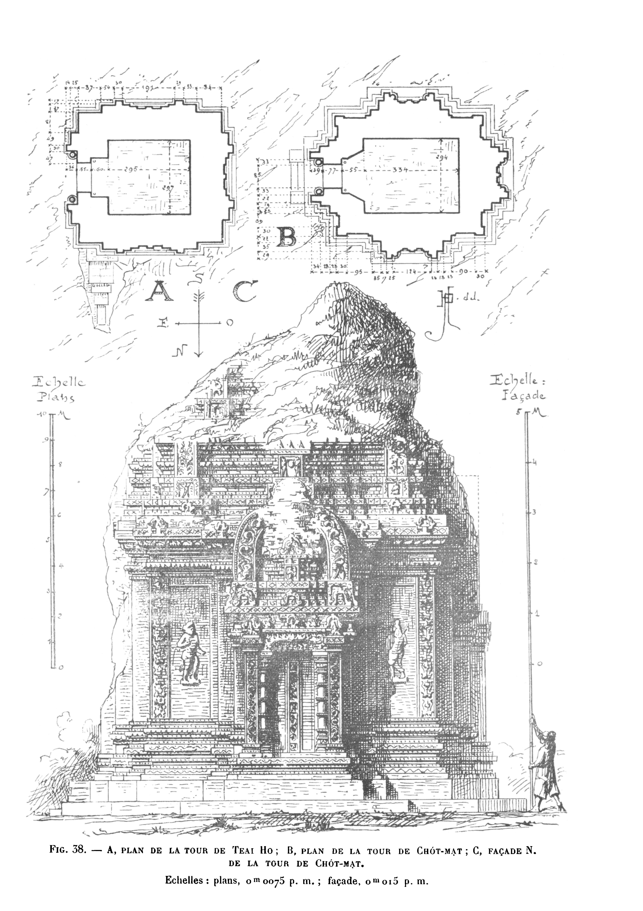
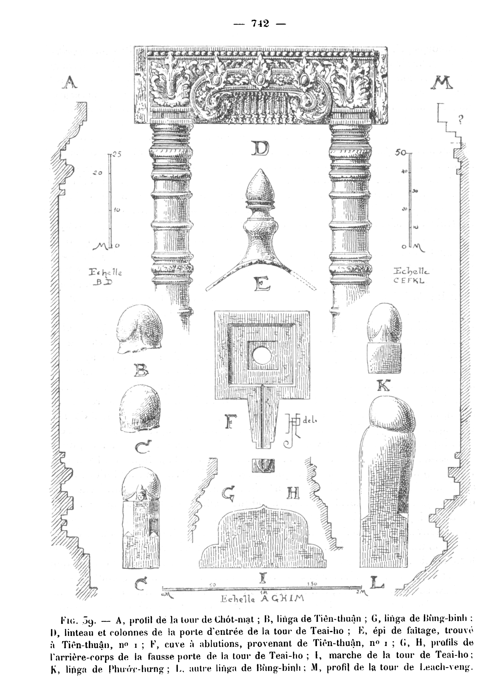

# Tháp Chót Mạt

*Bản đồ Di sản · Hồ sơ học thuật · Cập nhật 10/11/2026*

## 1. Thẻ trên bản đồ

Tháp Chót Mạt, tên Ba-bau trong khảo tả năm 1909, thuộc xã Thạnh Bình, tỉnh Tây Ninh. Parmentier ghi hai kiến trúc gạch, với tháp nhỏ nằm phía bắc tháp còn đứng. Năm 1938, Mauger gia cố góc tây bắc tháp chính và ghi tượng Viṣṇu ở tháp nhỏ. Phần mái và các mảng xây lại cần đọc cùng bản vẽ trước tu bổ.

## 2. Bài giới thiệu

### Ở đâu và có giá trị gì

Di tích nằm trên gò, trước đây thuộc xã Tân Phong, huyện Tân Biên, nay thuộc xã Thạnh Bình, tỉnh Tây Ninh. Phụ lục Quyết định 39/2025/QĐ-UBND ghi di tích kiến trúc nghệ thuật cấp quốc gia, xếp hạng theo Quyết định 937/QĐ-BT ngày 23/7/1993. Điểm GPS-0399 (11,463801° B, 106,010243° Đ, làm tròn) lấy từ KMZ của dự án. Mốc này đại diện cho di tích, chưa có sai số khảo sát độc lập. [1] [6]

### Kiến trúc

Parmentier ghi hai kiến trúc gạch. Công trình nhỏ đã đổ, nằm về phía bắc và hơi lùi so với trục ngang của tháp còn đứng. Ông nhận thấy dấu hào hẹp ở phía đông nam. Tháp chính mở đông, lệch khoảng 4° về nam theo phép ghi của ông. Lòng tháp hơi dài theo trục đông–tây, cửa cao khoảng 1,70 m. Tại cửa giả bắc, các lớp thân giật, trụ, cột và mi cửa được thể hiện bằng gạch. Hình 38B và 38C là bình đồ và mặt đứng bắc, hình 39A là mặt cắt biên dạng. Phần đỉnh nguyên thủy đã mất khi Parmentier khảo sát. Đề xuất của ông về dạng kết thúc kéo dài cần đọc như một phương án phục nguyên. [1] (tr. 740–745, hình 38–39) [2] (bản CIII)

### Điêu khắc và di vật

Khảo tả đầu thế kỷ XX ghi nhân vật chạm nổi giữa các trụ ốp, với các vật cầm như móc điều khiển voi, lao hoặc trượng. Mauger đọc một số nhân vật là thần giữ cửa (*dvārapāla*) và chụp mảng còn lại ở bản CIVb. Cũng năm 1938, ông ghi tìm thấy tượng Viṣṇu có cung đỡ bên trong tháp B. Tượng được đưa về Musée Blanchard de la Brosse. Danh mục *Lost Kingdoms* đối chiếu tượng Chót Mạt với số **BTMT 187**, Bảo tàng Mỹ thuật TP.HCM, và ghi kích thước **56 × 34 × 20 cm**. Một công bố khác dẫn số cao 55 cm. Cần phiếu kiểm kê để thống nhất quy cách đo. [1] [2] [3] [4]

### Lịch sử nghiên cứu và niên đại

Trong bài khảo sát năm 1909, Parmentier cho biết mô tả ban đầu dựa vào tin báo và ảnh của de Beylié. Khảo sát trực tiếp giúp ông sửa chú thích hình 37 từ mặt tây sang mặt bắc, đồng thời bổ sung bình đồ. Năm 1938, Mauger ước định mi cửa sa thạch vào khoảng thế kỷ VIII theo diễn biến hoa văn và nêu khả năng phần cửa giả nam hoàn thành muộn hơn, có thể thế kỷ IX. Tượng Viṣṇu được danh mục Met định niên cuối VI–đầu VII, trong khi Đặng Văn Thắng và Nguyễn Hữu Lý dẫn cách xếp thế kỷ VIII của Dupont qua Malleret. Các mốc này áp vào từng cấu kiện hoặc hiện vật. Chưa có năm khởi dựng được xác lập cho toàn cụm. [1] [2] [3] [4]

Nguyễn Hoàng Bách Linh ghi tên Chót Mạt trong chính văn tr. 40 và đánh số 57 trên bản đồ phân bố ở hình 12, tr. 50. [11]

### Văn khắc

Các nguồn đã đối chiếu chưa xác lập một văn khắc tại chỗ định niên tháp A hoặc B. Tên Chót-mat và Ba-bau là các tên trong khảo tả lịch sử. Tọa độ theo hệ grad năm 1909 được chính Parmentier lưu ý về độ chính xác, dùng để truy vết tài liệu địa lý cũ. [1] (tr. 740 và chú thích)

### Bảo tồn và hiện trạng

Năm 1938, Mauger dọn cây và đất đổ quanh tháp A, gia cố góc tây bắc, mở phần mặt trước tháp B. Ông ghi không phục hồi đỉnh A và không lắp lại mi cửa sa thạch đã đổ do thiếu cấu kiện và mốc. Võ Sĩ Khải ghi hai lần khảo sát lại tháng 11/1988 và 4/1989, khi công trình đã hư hỏng đáng kể. Dự án đầu thập niên 2000 được nguồn địa phương ghi mốc phê duyệt năm 2003. [10] (tr. 100–101) Đợt tôn tạo năm 2013 và các công việc được Bộ ghi nhận từ tháng 5/2023 có hạng mục bảo vệ hố khai quật, thoát nước hoặc hạ tầng tiếp cận, tùy đợt. Báo Tây Ninh ngày 05/11/2026 ghi dự án mới đã vào giai đoạn thi công. Cần hồ sơ nghiệm thu và bản vẽ hoàn công để phân biệt phần tôn tạo hiện đại với khối xây được ghi trước 1938. [2] [5] [7] [8] [9]

### Tôn giáo và tín ngưỡng

Viṣṇu ở tháp B hỗ trợ nhận diện hoạt động thờ tự Hindu tại cụm Chót Mạt. Mauger ghi tháp A từng bị xáo trộn và đợt mở năm 1938 không cho hiện vật trong lòng A. Vị trí tượng ở B và các thần giữ cửa chạm ở A cần lưu thành hai nhóm chứng cứ. Thần chủ của tháp A còn để ngỏ. [1] [2] [3]

## 3. Hồ sơ mở rộng

### Cách đọc hai tờ bản vẽ Parmentier

**Hình 38 · Bình đồ và mặt đứng bắc Chót Mạt.** B là bình đồ tháp chính Chót Mạt ở phía trên bên phải. C là mặt đứng bắc ở nửa dưới, nhìn vào cửa giả. A ở phía trên bên trái là tháp Teai Ho. La bàn đặt đông bên trái, bắc phía dưới. Tờ chen giữa tr. 744–745.

**Hình 39 · Biên dạng Chót Mạt và tư liệu đối chiếu.** Chỉ A, dải biên dạng ở mép trái, là Chót Mạt. D là mi cửa và cột cửa Teai Ho. M là biên dạng tháp Leach-veng. Đọc A theo thước tỷ lệ ở chân hình dùng chung cho A, G, H, I và M. Tr. 742.

**Hình 38 · Bình đồ và mặt đứng.** A là bình đồ tháp Teai Ho. B là bình đồ tháp chính Chót Mạt. Số đo ghi trong lòng B cho khoảng 3,34 × 2,94 m. Đây là kích thước lòng tháp trên bản vẽ, tách khỏi kích thước phủ bì. C là mặt đứng bắc, với cửa giả ở giữa và các mảng chạm hai bên. Tờ vẽ cho thấy tình trạng phế tích lúc khảo sát. Hình dạng đỉnh nguyên thủy còn để ngỏ.

**Hướng và tỷ lệ hình 38.** Theo ký hiệu la bàn trên tờ, đông ở bên trái và bắc ở phía dưới. Cửa thật phía đông nằm ở bên trái bình đồ B. Tỷ lệ in của bình đồ là 7,5 mm/m và của mặt đứng là 15 mm/m. Khi đọc bản số, dùng thước tỷ lệ riêng của từng phần vì ảnh có thể đã đổi kích thước.

**Hình 39 · Chỉ ký hiệu A thuộc Chót Mạt.** A ở mép trái là biên dạng thân và các gờ tháp. D, G, H và I thuộc Teai Ho. B, E và F thuộc Tiên Thuận. C và L là liṅga ở Bùng Bình. K là liṅga ở Phước Hưng. M là biên dạng tháp Leach-veng. Thước ở chân hình dùng chung cho A, G, H, I và M.

**Hai hệ ký hiệu A–B.** A và B ở hình 38 chỉ hai bình đồ của hai di tích. Trong báo cáo Mauger năm 1938, A và B lại chỉ hai kiến trúc trong cùng cụm Chót Mạt. Giữ riêng hai hệ ký hiệu khi đối chiếu.

Nguồn của cả hai tờ là Henri Parmentier, *Relevé archéologique de la province de Tây-Ninh*, BEFEO 9 (1909). Hình 38 ở tờ chen giữa tr. 744–745. Hình 39 ở tr. 742. [1]

### Đối chiếu trước và sau tu bổ

| Mốc tư liệu | Ghi nhận có thể kiểm | Phạm vi diễn giải |
|---|---|---|
| Parmentier 1909 | Tr. 740–745 mô tả tháp chính và phế tích bắc. Hình 38B, 38C và 39A minh họa tháp chính, trong đó mặt đứng bắc cho thấy cửa giả, các mảng chạm và dấu tầng trên. | Hai tầng có dấu là trạng thái quan sát. Số tầng và hình thức kết thúc đầy đủ cần chứng cứ bổ sung. |
| Mauger 1938 | Tr. 418–419, bản CIII–CIV. Gia cố góc tây bắc tháp A, mở mặt trước B, tìm tượng tại B. Ghi tình trạng mi cửa và phần đỉnh. | Hồ sơ tách công việc gia cố khỏi phần giả định phục nguyên. Tượng tìm ở B có hồ sơ lưu giữ riêng. |
| Dự án đầu những năm 2000 | Nguồn quản lý giới thiệu dự án phục hồi, bảo tồn và trưng bày hố khai quật. [5] | Cần nhật ký khai quật, bình đồ và hoàn công để xác định mốc thi công, phần gạch giữ lại và phần bổ sung. |
| 2013, 2023 và 2026 | Các nguồn công bố chống xói lở và hạ tầng năm 2013, nhà che, vệ sinh, mương, rào, đường vào trong đợt được thông tin năm 2024, và tiến độ thi công tháng 11/2026. [7] [8] [9] | Phân biệt công việc lên thân tháp, bảo vệ hố và chỉnh trang khuôn viên. Mỗi đợt cần hồ sơ riêng. |

### Dữ liệu, phân tích và giả thuyết

**Dữ liệu.** Hai kiến trúc được ghi nhận từ khảo sát đầu thế kỷ XX. Tư liệu năm 1938 nối được tượng Viṣṇu với khu tháp B, và xác định một lần gia cố góc tây bắc A. [1] [2]

**Phân tích.** Cửa đông, tổ hợp nhiều đền và các cửa giả nhô là tiêu chí so sánh với Bình Thạnh. Parmentier đặt Chót Mạt vào đối sánh nghệ thuật Khmer dựa trên hình thái. Giá trị của đối sánh nằm ở các cấu kiện có thể kiểm trên bản vẽ, ảnh và vật liệu. Phạm vi chính trị, nhóm thợ và trình tự truyền mẫu cần chứng cứ độc lập.

**Giả thuyết cần kiểm.** Thử xác định cửa giả nam có thuộc lần hoàn thiện muộn như Mauger gợi ý bằng mạch xây tiếp giáp và ảnh trước 1938. Đối chiếu bản CIII, hình 38 và hồ sơ hoàn công đầu những năm 2000 để lập bản đồ phần gốc, phần gia cố và phần phục hồi.

## 4. Thư mục

[1] Henri Parmentier. 1909. *Relevé archéologique de la province de Tây-Ninh (Cochinchine)*. BEFEO 9, tr. 739–756, riêng Chót Mạt tr. 740–745 và đối sánh tr. 754–756. Đọc bản PDF anh cung cấp trên ổ E, đã đối chiếu trùng từng byte với bản lưu trên ổ D. <https://www.persee.fr/doc/befeo_0336-1519_1909_num_9_1_1976>

[2] Henri Mauger. Báo cáo công việc tại Chót-mat, in trong *Chronique*, BEFEO 38 (1938), tr. 418–419, bản CIII–CIV. Đọc bản PDF lưu trên ổ E. <https://www.persee.fr/doc/befeo_0336-1519_1938_num_38_1_4761>

[3] The Metropolitan Museum of Art. 2014. *Lost Kingdoms: Hindu-Buddhist Sculpture of Early Southeast Asia*, tr. 140, mục 67. Đối chiếu checklist triển lãm, tr. 32, về xuất xứ Chót Mạt. <https://resources.metmuseum.org/resources/metpublications/pdf/Lost_Kingdoms_Hindu_Buddhist_Sculpture_of_Early_Southeast_Asia.pdf>

[4] Đặng Văn Thắng và Nguyễn Hữu Lý. *Thần Vishnu trong văn hóa Óc Eo*. Tạp chí Khảo cổ học số 4/2015, mục 1.2, bản đăng lại của Viện Hàn lâm Khoa học xã hội Việt Nam. <https://vass.gov.vn/nghien-cuu-khoa-hoc/than-vishnu-trong-van-hoa-oc-eo-575127>

[5] Cổng thông tin du lịch Tây Ninh. *Dấu ấn nền văn hóa Óc Eo cổ đại – Tháp cổ Chót Mạt*. Dùng phần lịch sử quản lý và dự án phục hồi. <https://dulich.longan.gov.vn/tin-tuc/dau-an-nen-van-hoa-oc-eo-co-dai-thap-co-chot-mat-1276>

[6] UBND tỉnh Tây Ninh. Phụ lục Quyết định 39/2025/QĐ-UBND, tr. 23, STT 136, mục Tháp Chót Mạt. <https://vbpl.vn/FileData/TW/Lists/vbpq/Attachments/183436/VanBanGoc_39_2025_Q%C4%90-UBND_07-11-2025_Phu%20luc%20DANH%20MUC%20DI%20TICH%20LS-VH%20TINH%20TAY%20NINH.signed.pdf>

[7] TTXVN. 10/9/2013. *Tu bổ và tôn tạo hai di tích tháp cổ ở tỉnh Tây Ninh*. <https://www.vietnamplus.vn/tu-bo-va-ton-tao-hai-di-tich-thap-co-o-tinh-tay-ninh-post219828.vnp>

[8] Bộ Văn hóa, Thể thao và Du lịch. 28/8/2024. *Tây Ninh chú trọng công tác trùng tu, bảo tồn các di tích, phát huy giá trị di sản văn hóa gắn với phát triển du lịch*. Mục về Chót Mạt và đợt tháng 5/2023. <https://bvhttdl.gov.vn/tay-ninh-chu-trong-cong-tac-trung-tu-bao-ton-cac-di-tich-phat-huy-gia-tri-di-san-van-hoa-gan-voi-phat-trien-du-lich-20240828143854452.htm>

[9] Báo Tây Ninh. 05/11/2026. *Phát huy giá trị văn hóa, thúc đẩy phát triển bền vững*. Phần tiến độ hai dự án tháp. <https://baotayninh.vn/phat-huy-gia-tri-van-hoa-thuc-day-phat-trien-ben-vung-352675.html>

[10] Võ Sĩ Khải. 2018. *Văn hóa Đồng bằng Nam Bộ – Di tích kiến trúc cổ. Kiến trúc trong văn hóa Óc Eo – hậu Óc Eo ở Nam Bộ*. NXB Khoa học xã hội, tái bản có chỉnh sửa, tr. 53, 100–101. Đọc bản quét trên ổ D. <https://phucvu.thuvientphcm.gov.vn/Item/ItemDetail/587254>

[11] Nguyễn Hoàng Bách Linh. 2023. Archaeology of the Oc Eo Culture (Southern Vietnam): Exploration, Research, and Achievements. Ancient Civilizations and Cultural Resources 1, tr. 39–70, riêng Chót Mạt tr. 40 và hình 12, số 57, tr. 50. <https://isac.w3.kanazawa-u.ac.jp/publication/doc/accr1-3_nguyen.pdf>
